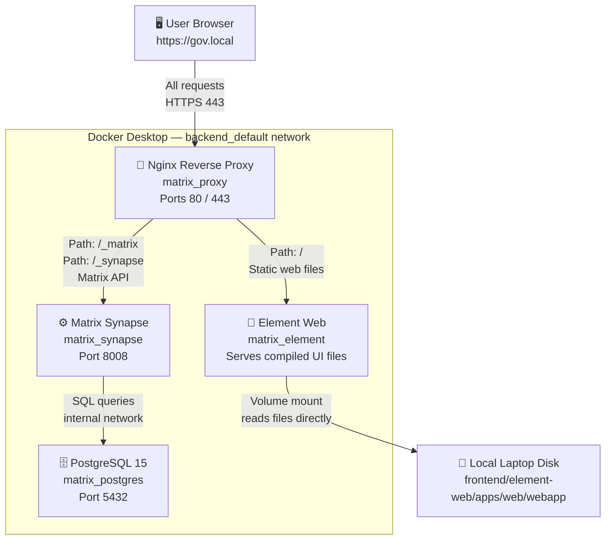
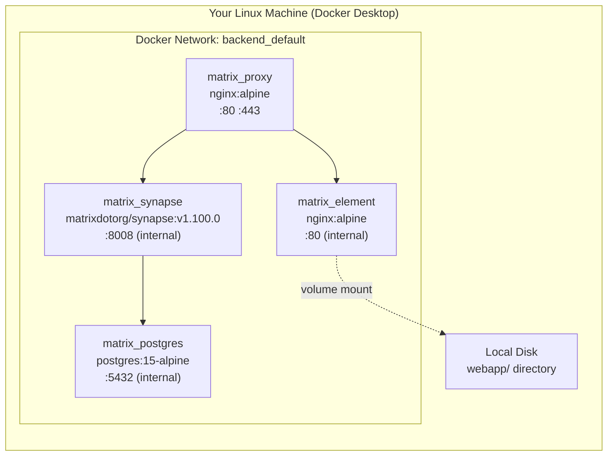
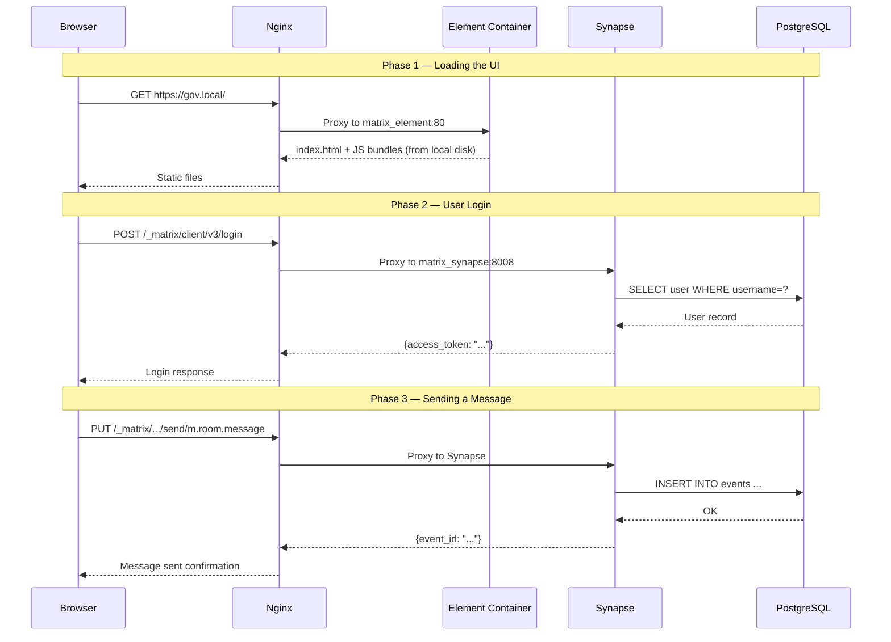

# System Overview

## Purpose

This document explains how every part of Sovereign Messenger connects, why each component exists, and what happens to the system if any part is removed or changed.

Read this first before touching anything else in the codebase.

---

## Problem

The Republic of Uzbekistan government needs a secure internal messaging system that:

- Runs entirely on government-controlled infrastructure (no cloud, no third parties)
- Supports end-to-end encryption
- Is accessible via a standard web browser
- Displays the interface in Uzbek and Russian
- Looks professional and recognizable to government staff

---

## Solution

The system is built on the **Matrix protocol** — an open, decentralized messaging standard. Think of Matrix as the "HTTP of messaging": it defines how messages are sent, stored, and federated, but lets anyone build their own server and client.

The components:

| Component | Role | Why this one |
|-----------|------|--------------|
| **Matrix Synapse** | The homeserver — stores all messages, users, rooms | Reference implementation, battle-tested, open source |
| **PostgreSQL 15** | Database — stores all Synapse data persistently | Synapse requires PostgreSQL for production; SQLite is dev-only |
| **Element Web** | Browser UI — the app users actually see and use | Most mature Matrix client; fully customizable source code |
| **Nginx** | Reverse proxy — routes all traffic, terminates SSL | Industry standard; handles HTTPS so other services don't have to |
| **Docker Desktop** | Container runtime — packages everything together | Ensures identical environment across machines |

---

## Architecture Diagram

---

## Container Map

---

## How It Works — Step by Step

### When a user opens the app

1. Browser visits `https://gov.local`
2. DNS resolves `gov.local` to `127.0.0.1` (via `/etc/hosts`)
3. Docker Desktop maps port `443` on the host to the `matrix_proxy` container
4. Nginx receives the request and checks the path:
   - Path `/` → proxy to `matrix_element:80` → Nginx in that container serves static files from the local `webapp/` directory
   - Path `/_matrix` or `/_synapse` → proxy to `matrix_synapse:8008`
5. Browser receives `index.html`, loads JavaScript bundles, applies the Sovereign Messenger theme, loads Uzbek translations

### When a user logs in

1. Element Web sends `POST https://gov.local/_matrix/client/v3/login`
2. Nginx forwards to Synapse on port 8008
3. Synapse validates credentials, queries PostgreSQL for the user record
4. PostgreSQL returns the user data
5. Synapse generates an access token, returns JSON to Nginx
6. Nginx returns the response to the browser
7. Element stores the token in localStorage and opens the main UI

### When a user sends a message

1. Element sends `PUT https://gov.local/_matrix/client/v3/rooms/{roomId}/send/m.room.message`
2. Nginx forwards to Synapse
3. Synapse processes the event, stores it in PostgreSQL, broadcasts to other room members
4. Other clients receive the event via their long-poll or WebSocket connection to Synapse

---

## Data Flow Diagram

---

## Important Files

| File | What It Does | What Breaks If Removed |
|------|-------------|----------------------|
| `backend/docker-compose.yml` | Defines all 4 containers and their network | Nothing runs |
| `nginx/default.conf` | All routing rules and SSL config | Traffic cannot reach Synapse or Element |
| `backend/synapse-data/homeserver.yaml` | All Synapse configuration | Synapse refuses to start |
| `frontend/config.json` | Tells Element which homeserver to connect to | Element connects to wrong server or fails |
| `frontend/element-web/apps/web/res/css/_sovereign.pcss` | All custom Telegram-style UI CSS | UI reverts to default Element appearance |
| `frontend/element-web/apps/web/src/i18n/strings/uz.json` | All Uzbek translations | UI shows English keys or raw key strings |
| `frontend/element-web/apps/web/webpack.config.ts` | Build configuration for the entire frontend | Cannot build or run the dev server |
| `certs/gov.local.crt` + `certs/gov.local.key` | SSL certificate for HTTPS | Nginx refuses to start; browser shows security error |

---

## Network Ports

| Port | Exposed On | Container | Purpose |
|------|-----------|-----------|---------|
| 80 | Host | matrix_proxy | HTTP (redirects to HTTPS) |
| 443 | Host | matrix_proxy | HTTPS — main entry point for all traffic |
| 8080 | Host | — (dev server) | webpack-dev-server in development mode |
| 8008 | Internal only | matrix_synapse | Matrix API — never exposed to the internet |
| 5432 | Internal only | matrix_postgres | PostgreSQL — never exposed to the internet |
| 80 | Internal only | matrix_element | Serves static web files to Nginx |

---

## Related Documents

- [Docker Containers](../Docker/containers.md)
- [Nginx Proxy](../Nginx/proxy.md)
- [Synapse Homeserver](../Backend/synapse.md)
- [PostgreSQL](../Backend/postgresql.md)
- [Element Web Customization](../Frontend/element-customization.md)
- [Development Mode](../Development/dev-mode.md)
