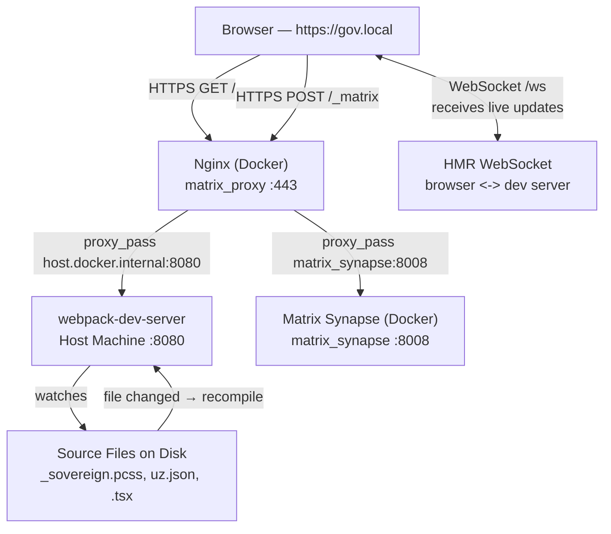

# Development Mode

## Purpose

Development mode lets you make changes to the Element Web frontend — CSS, translations, React components — and see those changes appear in the browser **automatically**, without running a full webpack build each time.

A full production build takes 45–90 seconds. Development mode gives you near-instant updates.

---

## Problem

During normal (production) operation, Element Web is compiled into static files in the `webapp/` directory, which are served by the `matrix_element` Docker container. Every time you change a single line of CSS, you would need to:

1. Run `pnpm --filter element-web build` (~60 seconds)
2. Run `docker compose restart element`
3. Hard-refresh the browser

That is unusable for active UI development.

---

## Solution

Run the **webpack development server** (`webpack-dev-server`) directly on your host machine. This server:

- Watches source files for changes
- Recompiles only the changed module (takes < 1 second)
- Pushes the update to the browser via a WebSocket connection (Hot Module Replacement / HMR)
- The browser updates the changed component without a full page reload

Synapse and PostgreSQL stay in Docker — you only replace the Element container with this local dev server.

Nginx is reconfigured to proxy `/` to `localhost:8080` (the dev server) instead of the Docker element container.

---

## How It Works



---

## Starting Development Mode

```bash
# One command — handles everything:
cd ~/Desktop/Sovereign-Messenger
./dev.sh
```

### What `dev.sh` Does (in order)

1. Runs `docker compose up -d postgres synapse nginx` — starts the backend in Docker
2. Runs `docker compose stop element` — stops the element Docker container
3. Runs `docker compose restart nginx` — reloads Nginx with the dev-mode proxy config
4. Copies `frontend/config.json` → `frontend/element-web/apps/web/webapp/config.json`
5. Runs `pnpm --filter element-web start` — starts the dev server on port 8080

### What You See

When the dev server is ready:

```
<i> [webpack-dev-server] Project is running at:
<i> [webpack-dev-server] Loopback: http://localhost:8080/
<i> [webpack-dev-server] On Your Network: http://192.168.x.x:8080/
```

Visit `https://gov.local` in your browser. The page loads from your local dev server through Nginx.

---

## Making Changes

### Editing the CSS Theme

Open `frontend/element-web/apps/web/res/css/_sovereign.pcss` and save the file.

Within 1–2 seconds:
- webpack recompiles the CSS module
- Browser receives the update via HMR
- New styles appear without a page reload

### Editing Uzbek Translations

Open `frontend/element-web/apps/web/src/i18n/strings/uz.json` and save.

Within 1–2 seconds the translation bundle is recompiled. **Note:** some translation changes require a browser refresh (Ctrl+F5) because they are cached in memory by the i18n library.

### Editing React Components (`.tsx` files)

Save the file. webpack recompiles the changed component. HMR attempts to swap the component in place. If the component cannot be hot-swapped, the page refreshes automatically.

---

## The Nginx Proxy Change

In development mode, `nginx/default.conf` is changed from:

```nginx
# Production (serves Docker container)
location / {
    proxy_pass http://matrix_element:80;
}
```

To:

```nginx
# Development (serves local webpack dev server)
location / {
    proxy_pass http://host.docker.internal:8080;
    proxy_http_version 1.1;
    proxy_set_header Upgrade $http_upgrade;
    proxy_set_header Connection "upgrade";
}
```

**`host.docker.internal`** is a special DNS name that Docker Desktop resolves to the IP address of your host machine. This is how the Nginx container inside Docker can reach the dev server running on your laptop.

The `Upgrade` and `Connection` headers are required for the HMR **WebSocket connection** to pass through Nginx. Without them, hot reload stops working and you get a WebSocket error in the browser console.

---

## Webpack Dev Server Configuration

Located in `frontend/element-web/apps/web/webpack.config.ts`:

```typescript
devServer: {
    host: "0.0.0.0",      // Bind to all interfaces, not just localhost
    port: 8080,            // Always port 8080

    client: {
        webSocketURL: "auto://0.0.0.0:0/ws",  // HMR connects back via browser URL
    },

    static: {
        directory: "./webapp",  // Serves static files from webapp/ (e.g., config.json)
    },

    devMiddleware: {
        writeToDisk: true,      // Writes compiled files to disk (for debugging)
        stats: "minimal",
    },

    hot: "only",           // HMR without automatic page refresh on failure
    allowedHosts: "all",   // Accept requests from any host (Nginx proxy)
}
```

**Why `host: "0.0.0.0"`?**
By default, webpack-dev-server only accepts connections from `127.0.0.1`. But Nginx inside Docker connects from a different IP. Setting `0.0.0.0` makes the server accept connections from anywhere — including Docker containers.

**Why `webSocketURL: "auto://0.0.0.0:0/ws"`?**
When the browser connects via `https://gov.local` (Nginx proxy), it needs to establish a WebSocket connection back to the dev server for HMR. The `auto://` scheme tells webpack to use the same host and port the browser is currently using — so the WebSocket goes through Nginx too, not directly to port 8080.

---

## Switching Back to Production Mode

```bash
cd ~/Desktop/Sovereign-Messenger
./prod.sh
```

This:
1. Runs `pnpm --filter element-web build` (full production build)
2. Rewrites `nginx/default.conf` back to `proxy_pass http://matrix_element:80`
3. Starts `matrix_element` Docker container
4. Restarts Nginx

---

## Common Mistakes

### "I changed a file but nothing happened in the browser"

- Check the terminal where `dev.sh` is running — if webpack shows an error, fix it first
- Check the browser console for WebSocket errors — if HMR connection failed, do a manual refresh
- Make sure you saved the file (sounds obvious, but)

### "The browser shows a blank page or connection refused"

- The dev server may still be compiling. Wait for the terminal to show `compiled successfully`
- Check that port 8080 is not already occupied: `lsof -i :8080`

### "Nginx shows 502 Bad Gateway"

- The dev server is not running yet, or it crashed
- Check the terminal for errors
- Make sure `dev.sh` finished starting before you open the browser

### "I see the old Element UI, not my customizations"

- Nginx may be serving a cached response. Restart it: `docker compose restart nginx` (from `backend/`)
- Hard refresh the browser: Ctrl+F5
- Check that the CSS file compiled: look in `webapp/bundles/_dev_/` for the CSS file

### "config.json not found / wrong homeserver"

- `dev.sh` copies `config.json` into `webapp/` automatically
- If you started the dev server manually without `dev.sh`, copy it yourself:
  ```bash
  cp frontend/config.json frontend/element-web/apps/web/webapp/config.json
  ```

---

## Stopping Development Mode

Press `Ctrl+C` in the terminal where `dev.sh` is running.

Note: Docker containers (Synapse, Postgres, Nginx) keep running. Only the webpack dev server stops.

To stop everything:
```bash
cd backend
docker compose down
```

---

## Rollback

If something goes wrong with dev mode and you want the full Docker production stack back immediately:

```bash
cd ~/Desktop/Sovereign-Messenger
./prod.sh
```

Or manually:
```bash
# In backend/
docker compose start element
docker compose restart nginx

# Manually restore nginx/default.conf location / block to:
# proxy_pass http://matrix_element:80;
```

---

## Related Documents

- [System Overview](../Architecture/system-overview.md)
- [Production Deployment](../Deployment/production.md)
- [Element Web Customization](../Frontend/element-customization.md)
- [Nginx Proxy](../Nginx/proxy.md)
- [ADR-0004: Development Mode Architecture](../ADRs/0004-development-mode.md)
