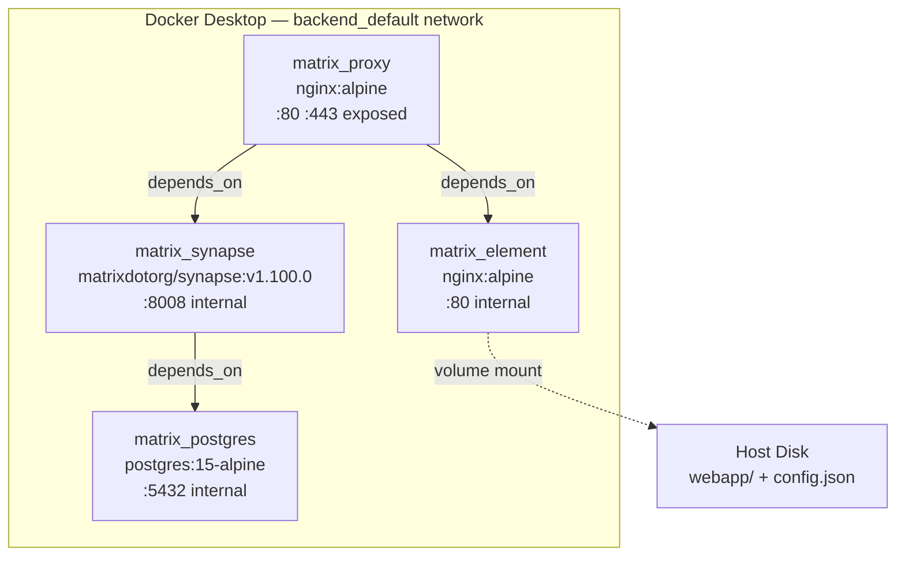
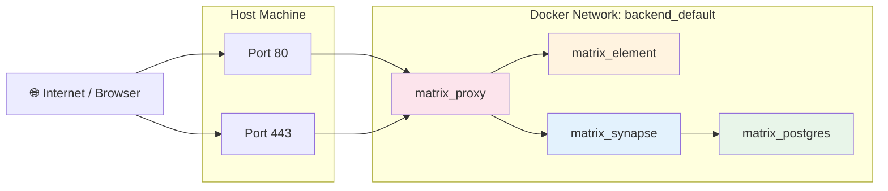

# Docker Containers

## Purpose

This document explains every Docker container in the project: what it is, why it exists, what it does, how it is configured, and what happens if it stops.

---

## What Is Docker Desktop?

Docker Desktop is a desktop application for Linux (and macOS/Windows) that runs Docker containers. It is different from the standalone Docker Engine:

- Docker Engine runs as a system-level daemon (`dockerd`), started via `systemctl start docker`
- Docker Desktop runs as a **user-space service**, started via `systemctl --user start docker-desktop` or the GUI

This project uses **Docker Desktop for Linux**. All `docker` CLI commands go through the Docker Desktop context, not a system docker daemon.

### Checking Docker Desktop Status

```bash
# Check if Docker Desktop is running
systemctl --user status docker-desktop

# Start Docker Desktop if it is stopped
systemctl --user start docker-desktop

# Verify CLI is connected to Docker Desktop context
docker context ls
# Active context should be: desktop-linux
```

> ⚠️ If you run `docker compose up` and get `Cannot connect to the Docker daemon`, Docker Desktop is not running. Start it first.

---

## Container Overview

All containers are defined in `backend/docker-compose.yml`.



---

## Container: `matrix_postgres`

### What It Is

PostgreSQL 15 — the relational database that stores all of Synapse's data.

### What It Stores

- User accounts and password hashes
- Room definitions and metadata
- All message events (the entire chat history)
- Device keys for end-to-end encryption
- Access tokens for logged-in sessions
- Media metadata

### Configuration

```yaml
image: postgres:15-alpine
container_name: matrix_postgres
environment:
  POSTGRES_USER: synapse_user
  POSTGRES_PASSWORD: SecretGovernmentPassword123!
  POSTGRES_DB: synapse
  POSTGRES_INITDB_ARGS: "--encoding=UTF-8 --lc-collate=C --lc-ctype=C"
volumes:
  - postgres_data:/var/lib/postgresql/data
restart: unless-stopped
```

**Why `--lc-collate=C --lc-ctype=C`?**
Synapse's documentation requires the PostgreSQL database to use `C` locale for collation and character type. This ensures correct string sorting and comparison for Matrix event IDs and room aliases. Using any other locale can cause silent bugs in Synapse's queries.

**Why a named volume (`postgres_data`) not a bind mount?**
Named volumes are managed by Docker and survive container restarts and rebuilds. If you used a bind mount (a folder on disk), you would need to manage permissions manually and the data could get wiped accidentally.

### What Breaks If This Stops

Everything. Synapse cannot function without PostgreSQL. Users cannot log in. Messages cannot be sent. The entire service becomes unavailable.

### Accessing the Database

```bash
docker exec -it matrix_postgres psql -U synapse_user -d synapse
```

---

## Container: `matrix_synapse`

### What It Is

Matrix Synapse — the homeserver. This is the core of the entire messaging system.

Think of it as the "post office" for Matrix messages. It:
- Receives messages from clients (Element)
- Stores them in PostgreSQL
- Delivers them to other clients in the same room
- Manages user accounts, rooms, device keys, end-to-end encryption metadata

### Configuration

```yaml
image: matrixdotorg/synapse:v1.100.0
container_name: matrix_synapse
volumes:
  - ./synapse-data:/data   # All config and data lives here
depends_on:
  - postgres
restart: unless-stopped
```

The most important file is `backend/synapse-data/homeserver.yaml`. See [Backend/synapse.md](../Backend/synapse.md) for full details.

### Port

Synapse listens on **port 8008** inside the Docker network. This port is **never exposed to the host machine or the internet**. Only Nginx (in the same Docker network) can reach it.

### What Breaks If This Stops

Users cannot log in. Messages cannot be sent or received. The UI will show "Cannot reach homeserver" errors.

### Shell Access

```bash
# Use the helper script
./backend/connect_synapse.sh

# Or directly
docker exec -it matrix_synapse /bin/bash
```

---

## Container: `matrix_element`

### What It Is

An Nginx Alpine web server that serves the compiled Element Web static files.

This container does **not** run Element Web's JavaScript. It simply serves the pre-compiled HTML, JS, CSS, and asset files that the user's browser downloads and executes.

### In Production Mode

```yaml
image: nginx:alpine
container_name: matrix_element
volumes:
  - ../frontend/element-web/apps/web/webapp:/usr/share/nginx/html:ro
  - ../frontend/config.json:/usr/share/nginx/html/config.json:ro
restart: unless-stopped
```

The two volume mounts explain everything:

1. `webapp/` → `/usr/share/nginx/html` — The compiled output of `pnpm --filter element-web build`. Contains all JS bundles, CSS themes, images, fonts.
2. `config.json` → `/usr/share/nginx/html/config.json` — Tells Element which Matrix homeserver to connect to. This is injected at runtime, not baked into the build.

**This means you do NOT need to rebuild the Docker image when you make changes.** You rebuild the webpack bundle (`pnpm build`), which updates files in `webapp/` on your disk, and the container serves them immediately.

### In Development Mode

This container is stopped (`docker compose stop element`). The webpack-dev-server running on your host machine takes its role. See [Development Mode](../Development/dev-mode.md).

### What Breaks If This Stops

In production mode: users see a 502 error or blank page because Nginx cannot proxy to this container.

In development mode: nothing, because the dev server is running instead.

---

## Container: `matrix_proxy`

### What It Is

Nginx Alpine acting as a **reverse proxy** and **SSL termination point**.

This is the only container that exposes ports to the outside world (`80` and `443`). Every single request from every browser goes through this container first.

### What It Does

- Listens on port 80 → redirects everything to port 443 (HTTPS)
- Listens on port 443 → terminates SSL (decrypts HTTPS)
- Routes requests based on URL path:
  - `/` → forwards to the Element Web server
  - `/_matrix` and `/_synapse` → forwards to Synapse

### Configuration

```yaml
image: nginx:alpine
container_name: matrix_proxy
ports:
  - "80:80"
  - "443:443"
volumes:
  - ../nginx/default.conf:/etc/nginx/conf.d/default.conf:ro
  - ../certs:/etc/nginx/certs:ro
depends_on:
  - synapse
  - element
restart: unless-stopped
```

See [Nginx Proxy](../Nginx/proxy.md) for full routing configuration.

### What Breaks If This Stops

Everything. No browser can reach anything. The entire service appears offline.

---

## Docker Networking

All containers share the `backend_default` network, created automatically by Docker Compose. On this network:

- Containers can reach each other by **container name** (e.g., `matrix_synapse:8008`)
- No container is reachable from the host unless it explicitly publishes a port
- The outside internet cannot reach Synapse or PostgreSQL directly — only Nginx



---

## Resource Requirements

Docker Desktop must be allocated sufficient resources. Open Docker Desktop → Settings → Resources:

| Resource | Minimum | Recommended |
|----------|---------|-------------|
| Memory | 2 GB | 4 GB+ |
| CPU | 2 cores | 4 cores |
| Disk | 10 GB | 20 GB+ |

> ⚠️ If containers exit with code `137`, they were killed by the OS for using too much memory. Increase the memory limit in Docker Desktop settings.

---

## Common Operations

```bash
# Navigate to backend directory first
cd ~/Desktop/Sovereign-Messenger/backend

# Start everything
docker compose up -d

# Check what is running
docker compose ps

# View logs (follow mode)
docker compose logs -f synapse

# Restart a single container
docker compose restart nginx

# Stop a single container (without removing it)
docker compose stop element

# Start a stopped container
docker compose start element

# Stop all containers and remove them (data volumes survive)
docker compose down

# Nuclear option — remove everything including volumes (DELETES ALL DATA)
docker compose down -v
```

> ⚠️ `docker compose down -v` **permanently deletes all PostgreSQL data**. Only use if you want to start completely fresh.

---

## Related Documents

- [Nginx Proxy](../Nginx/proxy.md)
- [Synapse Homeserver](../Backend/synapse.md)
- [PostgreSQL](../Backend/postgresql.md)
- [Development Mode](../Development/dev-mode.md)
- [ADR-0001: Matrix Synapse as Backend](../ADRs/0001-matrix-synapse-as-backend.md)
