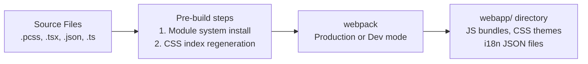

# Element Web Customization

## Purpose

This document explains every customization made to Element Web — why each one was made, what file contains it, and what would happen if it were reverted.

---

## What Is Element Web?

Element Web is an open-source browser-based Matrix client. It is a React application — a single-page app that loads in the browser and communicates with the Matrix homeserver (Synapse) via the Matrix Client-Server API.

We did not build a custom client from scratch. We took Element Web's source code, which is publicly available, and modified it. This approach gives us a fully functional, battle-tested messaging client that we only needed to customize for branding, language, and appearance.

---

## Source Code Location

```
frontend/element-web/         ← The full Element Web source repository
apps/web/                     ← The main web application
  src/                        ← React source code
  res/                        ← Static resources (CSS, images, fonts)
  I18nWebpackPlugin.ts        ← Custom build plugin for language support
  webpack.config.ts           ← Build system configuration
```

---

## Customizations

### 1. Application Name & Branding

**File:** `frontend/element-web/apps/web/src/vector/index.html`

Changed the browser tab title and meta tags:

```html
<title>Sovereign Messenger</title>
<meta name="apple-mobile-web-app-title" content="Sovereign Messenger">
<meta name="application-name" content="Sovereign Messenger">
<meta name="theme-color" content="#071526">
```

Also added the Inter font via `<link>` tag (loading it in HTML avoids a PostCSS parsing error that occurs when `@import url()` with semicolons inside the URL is processed by webpack).

---

### 2. Runtime Configuration (`config.json`)

**File:** `frontend/config.json`

This is the most important file for connecting Element Web to our Synapse instance. It is not baked into the webpack build — it is served as a plain JSON file at runtime, so Element loads it when it starts.

Key settings explained:

```json
{
    "default_server_config": {
        "m.homeserver": {
            "base_url": "https://gov.local",
            "server_name": "gov.local"
        }
    },
```
Tells Element which Matrix homeserver to connect to. `base_url` is where the API calls go. `server_name` is the domain used in Matrix IDs (`@user:gov.local`).

```json
    "disable_custom_urls": true,
```
Prevents users from changing the homeserver to something else (like matrix.org). The server selector is hidden from the login screen.

```json
    "brand": "Sovereign Messenger",
```
Replaces all occurrences of "Element" in the UI with "Sovereign Messenger".

```json
    "default_theme": "dark",
```
Sets the dark theme as default on first load.

```json
    "branding": {
        "auth_header_logo_url": "themes/element/img/logos/uzbekistan_state_seal.png"
    },
```
Replaces the Element logo on the login screen with the Uzbekistan state seal.

```json
    "setting_defaults": {
        "language": "uz"
    },
```
Sets Uzbek as the default language for all new users.

```json
    "features": {
        "feature_thread": true,
        "feature_pinning": true
    }
```
Explicitly enables threaded replies and message pinning, which are stable features but controlled via feature flags.

---

### 3. Telegram Web Theme (CSS)

**File:** `frontend/element-web/apps/web/res/css/_sovereign.pcss`

This file is the heart of the visual customization. It overrides Element Web's default design system using CSS custom properties (variables) and direct class selectors.

**Why `.pcss`?**
PostCSS — a CSS preprocessor. Element Web uses PostCSS to process CSS files. Our file is included in the main CSS bundle automatically because `_sovereign.pcss` is imported into the main stylesheet index.

**Design choices:**

| Design Element | Our Value | Telegram Equivalent |
|----------------|-----------|---------------------|
| Sidebar background | `#17212b` | Telegram sidebar |
| Chat canvas | `#0e1621` | Telegram chat background |
| Incoming message bubble | `#182533` | Telegram received bubble |
| Outgoing message bubble | `#2b5278` | Telegram sent bubble |
| Accent / links | `#5288c1` | Telegram blue |
| Avatar shape | `border-radius: 50%` | Circular |
| Chat list item | 68px height, 12px radius | Telegram tile |
| Unread badge | `#40a7e3` pill | Telegram unread count |

The file overrides **two layers** of Element's CSS variable system:
1. **Compound Design System variables** (`--cpd-color-*`) — Element's newer design system
2. **Legacy theme variables** (`--accent`, `--background`, `--roomlist-*`) — older variables still used by many components

Both must be overridden because different parts of the UI use different variable systems.

See [Theming](./theming.md) for the detailed CSS breakdown.

---

### 4. Uzbek Translations

**File:** `frontend/element-web/apps/web/src/i18n/strings/uz.json`

Provides Uzbek-language text for 350+ UI strings. The format is nested JSON matching the structure of the source English file (`en_EN.json`).

**How it works:** When Element renders a UI element, it looks up a translation key like `action.send` in the currently active language file. If the key is found in `uz.json`, that text is shown. If not found, it falls back to `en_EN.json`.

See [Internationalization](./i18n.md) for full details.

---

### 5. Language Build Plugin

**File:** `frontend/element-web/apps/web/I18nWebpackPlugin.ts`

This plugin runs during the webpack build. It reads all `*.json` translation files in the `src/i18n/strings/` directory and:

1. Filters to only include specified languages
2. Outputs them to the `webapp/i18n/` directory
3. Creates a `languages.json` manifest listing available languages

We modified the filter to include `uz`, `ru`, and `en_EN`:

```typescript
// Original (only English):
// if (lang === "en_EN") { ... }

// Our modification:
const allowedLangs = ["uz", "ru", "en_EN"];
if (allowedLangs.includes(lang)) { ... }
```

Without this change, the build would not output `uz.json` or `ru.json` to the webapp, and the language selector would not show them.

---

### 6. Russian Language in UI Selector

**File:** `frontend/element-web/apps/web/src/i18n/utils.ts`

Added Russian to the list of languages shown in the Settings → Language dropdown:

```typescript
{ label: "Русский", value: "ru" }
```

---

## Build Pipeline



```bash
# Full production build (~60 seconds)
pnpm --filter element-web build

# Development server with hot reload
pnpm --filter element-web start
```

The build output in `webapp/` is what gets served to browsers — either by the `matrix_element` Docker container or by the webpack dev server.

---

## Adding New Customizations

### Changing Colors or Layout

Edit `res/css/_sovereign.pcss`. In dev mode, changes appear in the browser within 1–2 seconds.

### Adding a New Translation Key

1. Add the key and English text to `src/i18n/strings/en_EN.json`
2. Add the Uzbek translation to `src/i18n/strings/uz.json`
3. Optionally add Russian to `ru.json`
4. The change takes effect on the next build (or immediately in dev mode)

### Replacing the Logo

The logo is referenced in `frontend/config.json`:
```json
"auth_header_logo_url": "themes/element/img/logos/uzbekistan_state_seal.png"
```

The file lives at `frontend/element-web/apps/web/res/themes/element/img/logos/uzbekistan_state_seal.png`. Replace the file and rebuild.

---

## What Would Break If Reverted

| Customization | If Removed |
|---------------|-----------|
| `config.json` | Element connects to matrix.org instead of gov.local |
| `_sovereign.pcss` | UI reverts to default Element blue/white theme |
| `uz.json` | UI displays in English only |
| `I18nWebpackPlugin.ts` changes | No Uzbek/Russian files in build output |
| `utils.ts` changes | Russian not shown in language selector |

---

## Related Documents

- [Theming (CSS Details)](./theming.md)
- [Internationalization (i18n)](./i18n.md)
- [Development Mode](../Development/dev-mode.md)
- [ADR-0002: Element Web as Frontend](../ADRs/0002-element-web-as-frontend.md)
- [ADR-0005: Telegram UI Theme](../ADRs/0005-telegram-ui-theme.md)
