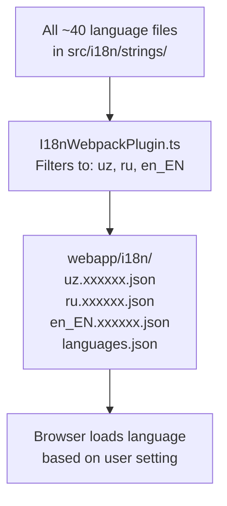

# Internationalization (i18n) — Uzbek & Russian Language Support

## Purpose

Sovereign Messenger must display the interface in Uzbek (primary) and Russian (secondary), as these are the working languages of Uzbekistan government staff. English is kept as a fallback for untranslated strings.

---

## How Element Web's i18n System Works

Element Web uses a JSON-based translation system. Every visible text string in the UI is referenced by a **translation key** (not written directly in the code).

Example — instead of hardcoding:
```tsx
<button>Send message</button>
```

Element does:
```tsx
<button>{_t("action.send")}</button>
```

When the component renders, `_t("action.send")` looks up the key `action.send` in the currently active language file and returns the translated string.

**Fallback chain:** `uz` → `en_EN`

If a key exists in `uz.json`, that value is shown. If the key is missing from `uz.json`, the English value from `en_EN.json` is shown. This means we can translate incrementally — untranslated strings gracefully show in English, never as raw key names.

---

## Translation Files

```
frontend/element-web/apps/web/src/i18n/strings/
├── en_EN.json    # English — source of truth, 4101 lines, all UI strings
├── uz.json       # Uzbek — our custom file, 350+ key-value pairs
└── ru.json       # Russian — community translation, included by our build plugin
```

### File Format

All files use nested JSON. The nesting follows a logical grouping:

```json
{
    "action": {
        "send": "Yuborish",
        "cancel": "Bekor qilish",
        "login": "Tizimga kirish"
    },
    "auth": {
        "sign_in_description": "Tizimga kirish uchun hisobingizdan foydalaning.",
        "forgot_password_prompt": "Parolni unutdingizmi?"
    },
    "common": {
        "loading": "Yuklanmoqda...",
        "error": "Xatolik"
    }
}
```

Some strings contain variables:
```json
"n_unread_messages": {
    "one": "%(count)s ta o'qilmagan xabar.",
    "other": "%(count)s ta o'qilmagan xabar."
}
```

`%(count)s` is a placeholder that gets replaced with the actual count at runtime.

---

## Build Pipeline — How Languages Get Into the App

The standard Element Web build includes ~40+ languages. For Sovereign Messenger, we only need 3. The `I18nWebpackPlugin.ts` file controls this:



**Why filter to only 3 languages?**
The full ~40 language build increases build time and output size unnecessarily. Keeping only the languages we use makes the build faster and the `webapp/i18n/` directory cleaner.

**The `languages.json` manifest:**
This file tells Element Web which languages are available. It is generated automatically by the plugin. It looks like:

```json
[
    {"value": "en_EN", "label": "English"},
    {"value": "ru", "label": "Русский"},
    {"value": "uz", "label": "O'zbek"}
]
```

---

## Language Selector in UI

**File:** `frontend/element-web/apps/web/src/i18n/utils.ts`

The function `getAllLanguagesWithLabels()` populates the language dropdown in Settings. We added Russian and Uzbek here:

```typescript
// Languages available in Settings → Language
const KNOWN_LANGUAGES = [
    { value: "uz", label: "O'zbek" },
    { value: "ru", label: "Русский" },
    { value: "en_EN", label: "English" },
];
```

Without editing this file, the language selector would show the full list of 40+ languages from the community, which is confusing for our government deployment.

---

## Default Language

Set in `frontend/config.json`:

```json
"setting_defaults": {
    "language": "uz"
}
```

Every new user sees the UI in Uzbek by default. They can change it to Russian or English in Settings → Language.

---

## Current Translation Coverage

Our `uz.json` covers the following major UI sections:

| Section | Keys Covered | What It Covers |
|---------|-------------|---------------|
| `action` | 60+ keys | All buttons: Send, Cancel, Login, Create, Edit, Delete... |
| `auth` | 20+ keys | Login form, registration, password reset, error messages |
| `common` | 40+ keys | General terms: Loading, Error, Settings, Home, Rooms... |
| `composer` | 10 keys | Message input area: placeholder text, send button |
| `create_room` | 12 keys | Room creation dialog |
| `keyboard` | 35+ keys | All keyboard shortcut descriptions |
| `room` | 20+ keys | Room header, member panel, file list |
| `room_list` | 25+ keys | Chat list filters, sorting, empty states |
| `room_settings` | 8 keys | Room settings dialog tabs |
| `settings` | 10 keys | Settings panel tab labels |
| `encryption` | 8 keys | Verification dialog |
| `user_menu` | 5 keys | User avatar dropdown menu |
| `notifications` | 5 keys | Notification level labels |
| `threads` | 4 keys | Threaded reply UI |
| `poll` | 6 keys | Poll creation and voting UI |

**Fallback:** Any key not in `uz.json` automatically shows the English text from `en_EN.json`. The UI never shows raw key names.

---

## Adding or Fixing a Translation

1. Find the key in `en_EN.json` (search the file for the English text you see in the UI)
2. Add or update the same key in `uz.json` with the Uzbek translation
3. In development mode: the change appears after webpack recompiles (1–2 seconds)
4. In production mode: rebuild with `pnpm --filter element-web build`

### Example

You see "Search" in the UI but want it to say "Qidirish". Find the key:

```bash
grep -r '"Search"' frontend/element-web/apps/web/src/i18n/strings/en_EN.json
# → "search": "Search"  under the "action" section
```

Add to `uz.json`:
```json
"action": {
    "search": "Qidirish"
}
```

---

## Common Mistakes

### "I added a translation but the UI still shows English"

- In dev mode: did webpack recompile? Check the terminal
- In production: did you rebuild? Run `pnpm --filter element-web build`
- Is the key path correct? Nested keys must match exactly: `action.search` not `actions.search`
- Try a hard refresh (Ctrl+F5) — old translations may be cached

### "The language selector doesn't show Uzbek"

- Make sure `uz.json` is in `src/i18n/strings/`
- Make sure `I18nWebpackPlugin.ts` includes `"uz"` in the allowed languages list
- Rebuild and hard refresh

---

## Related Documents

- [Element Web Customization](./element-customization.md)
- [ADR-0006: Uzbek and Russian Language Support](../ADRs/0006-uzbek-russian-i18n.md)
