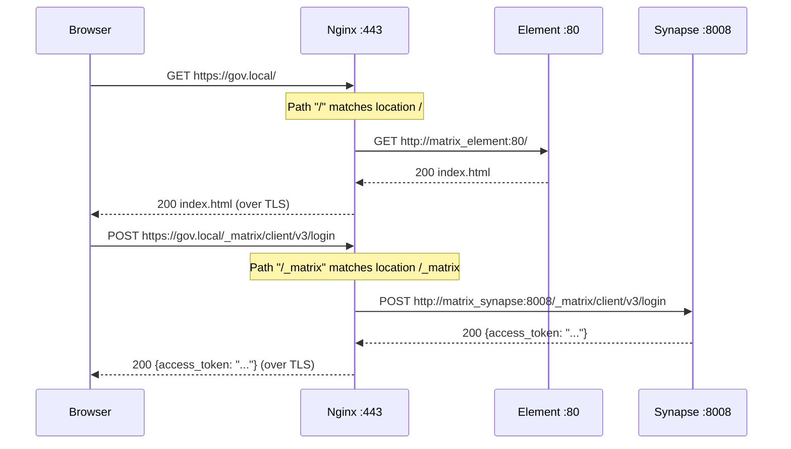

# Nginx Reverse Proxy

## Purpose

Nginx is the single entry point for all network traffic entering the system. It handles HTTPS encryption, routes requests to the correct service, and hides internal services from the outside world.

---

## Problem

Two services need to be accessible via a web browser on the same HTTPS port (443):

1. **Element Web** (the UI) — static HTML/JS/CSS files
2. **Matrix Synapse** (the API) — JSON endpoints under `/_matrix`

A browser can only connect to one port. Both services need to share port 443. Additionally, neither service handles HTTPS encryption itself — that complexity should be centralized.

---

## Solution

Nginx sits in front of everything as a **reverse proxy**. A reverse proxy receives all incoming requests and forwards them to the appropriate backend based on rules you define.

Think of it as a receptionist: every visitor goes to the receptionist first, the receptionist reads the request and directs it to the right department.

---

## Configuration File

**Location:** `nginx/default.conf`

Full content explained:

```nginx
# Block 1: HTTP → HTTPS redirect
server {
    listen 80;
    server_name gov.local localhost 127.0.0.1;
    return 301 https://$host$request_uri;
}
```

Any request arriving on plain HTTP (port 80) is immediately redirected to the same URL but with HTTPS. The browser is never served anything over unencrypted HTTP.

```nginx
# Block 2: The main HTTPS server
server {
    listen 443 ssl;
    server_name gov.local localhost 127.0.0.1;

    ssl_certificate /etc/nginx/certs/gov.local.crt;
    ssl_certificate_key /etc/nginx/certs/gov.local.key;

    ssl_protocols TLSv1.2 TLSv1.3;
    ssl_ciphers HIGH:!aNULL:!MD5;
```

Nginx loads the self-signed SSL certificate and key. `TLSv1.2` and `TLSv1.3` are modern, secure protocol versions. Older insecure protocols (TLSv1.0, SSL) are not listed and therefore rejected.

### Route 1: Serving the Web UI

**Production mode:**
```nginx
location / {
    proxy_pass http://matrix_element:80;
    proxy_set_header Host $host;
    proxy_set_header X-Real-IP $remote_addr;
    proxy_set_header X-Forwarded-For $proxy_add_x_forwarded_for;
    proxy_set_header X-Forwarded-Proto https;
}
```

**Development mode:**
```nginx
location / {
    proxy_pass http://host.docker.internal:8080;
    proxy_set_header Host $host;
    proxy_set_header X-Real-IP $remote_addr;
    proxy_set_header X-Forwarded-For $proxy_add_x_forwarded_for;
    proxy_set_header X-Forwarded-Proto https;

    # WebSocket headers for HMR
    proxy_http_version 1.1;
    proxy_set_header Upgrade $http_upgrade;
    proxy_set_header Connection "upgrade";
}
```

The `proxy_set_header` lines pass important metadata to the backend:
- `Host` — tells the backend what domain the client requested (needed for Matrix federation)
- `X-Real-IP` — the client's real IP address (useful for logging and rate limiting in Synapse)
- `X-Forwarded-For` — chain of IPs if there are multiple proxies
- `X-Forwarded-Proto: https` — tells Synapse that the client is connected via HTTPS, even though Nginx talks to Synapse over HTTP internally

Without `X-Forwarded-Proto: https`, Synapse would generate HTTP URLs in its responses (e.g., for media downloads), which would then fail in the browser because the browser is on HTTPS.

### Route 2: Matrix API

```nginx
location /_matrix {
    proxy_pass http://matrix_synapse:8008;
    proxy_set_header Host $host;
    proxy_set_header X-Real-IP $remote_addr;
    proxy_set_header X-Forwarded-For $proxy_add_x_forwarded_for;
    proxy_set_header X-Forwarded-Proto https;
    client_max_body_size 50M;
}
```

All requests starting with `/_matrix` are forwarded to Synapse. The `client_max_body_size 50M` allows users to upload files up to 50MB. Without this, Nginx would reject uploads larger than its 1MB default.

### Route 3: Synapse Admin API

```nginx
location /_synapse {
    proxy_pass http://matrix_synapse:8008;
    ...
}
```

`/_synapse/admin` is Synapse's administrative API for creating users, querying rooms, etc. This is only accessible if you have an admin access token.

### Route 4: Synapse Admin Web UI

```nginx
location /admin/ {
    proxy_pass         http://matrix_admin:80/;
    proxy_set_header   Host              $host;
    proxy_set_header   X-Real-IP         $remote_addr;
    proxy_set_header   X-Forwarded-For   $proxy_add_x_forwarded_for;
    proxy_set_header   X-Forwarded-Proto https;
}
```

`/admin/` routes traffic to the `matrix_admin` (`synapse-admin`) container.

---

## Request Flow Diagram



---

## SSL Certificate Setup

The certificates are self-signed and stored in `certs/`:

```
certs/
├── gov.local.crt    # Public certificate
└── gov.local.key    # Private key (never commit this to version control)
```

**Self-signed certificates** means they were created locally, not by a trusted Certificate Authority (like Let's Encrypt). This causes browsers to show a security warning on first visit. For a local government intranet, this is acceptable. For internet-facing deployment, replace with Let's Encrypt or an officially issued certificate.

### Generating New Certificates (if expired or lost)

```bash
cd ~/Desktop/Sovereign-Messenger/certs

openssl req -x509 -nodes -days 3650 -newkey rsa:4096 \
  -keyout gov.local.key \
  -out gov.local.crt \
  -subj "/C=UZ/ST=Tashkent/L=Tashkent/O=Government/CN=gov.local" \
  -addext "subjectAltName=DNS:gov.local,IP:127.0.0.1"
```

Then restart Nginx:
```bash
cd backend && docker compose restart nginx
```

---

## Switching Between Dev and Production Mode

The only difference between dev and production mode is the `location /` block in `nginx/default.conf`.

This is handled automatically by `dev.sh` and `prod.sh`. Do not manually edit this file unless you understand the consequences.

---

## Common Mistakes

### "502 Bad Gateway"

Nginx reached the backend but got no response. Causes:
- The element container or dev server is not running
- Synapse is still starting up (wait 10–15 seconds after `docker compose up`)
- A container crashed — check `docker compose logs synapse` or `docker compose logs element`

### "SSL_ERROR_RX_RECORD_TOO_LONG" in Firefox

You are accessing the service over HTTP when it expects HTTPS, or vice versa. Make sure you use `https://gov.local`.

### "NET::ERR_CERT_AUTHORITY_INVALID"

The browser does not trust the self-signed certificate. This is expected. Click "Advanced" → "Proceed to gov.local".

To permanently trust it, add the certificate to your system's certificate store:
```bash
sudo cp certs/gov.local.crt /usr/local/share/ca-certificates/gov.local.crt
sudo update-ca-certificates
```

### Nginx Not Reloading Config Changes

After editing `nginx/default.conf`, restart the container:
```bash
cd backend && docker compose restart nginx
```

Nginx does not auto-reload its config file when it changes.

---

## Debugging

```bash
# Check Nginx is running
docker compose ps nginx

# View access and error logs
docker compose logs -f nginx

# Test Nginx config syntax without restarting
docker exec matrix_proxy nginx -t

# Reload config without downtime (graceful)
docker exec matrix_proxy nginx -s reload
```

---

## What Would Break If Nginx Were Removed

- No HTTPS — browsers cannot connect
- No routing — there is no way to reach either Element or Synapse from a browser
- The entire system becomes inaccessible

---

## Related Documents

- [System Overview](../Architecture/system-overview.md)
- [SSL Certificates](../Security/ssl-certificates.md)
- [Development Mode](../Development/dev-mode.md)
- [Docker Containers](../Docker/containers.md)
